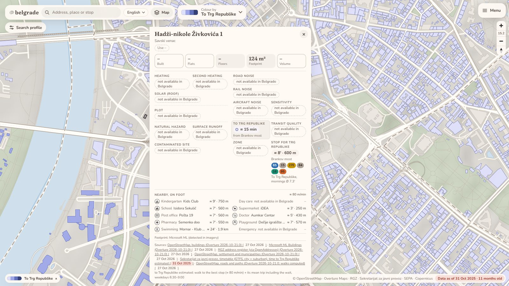
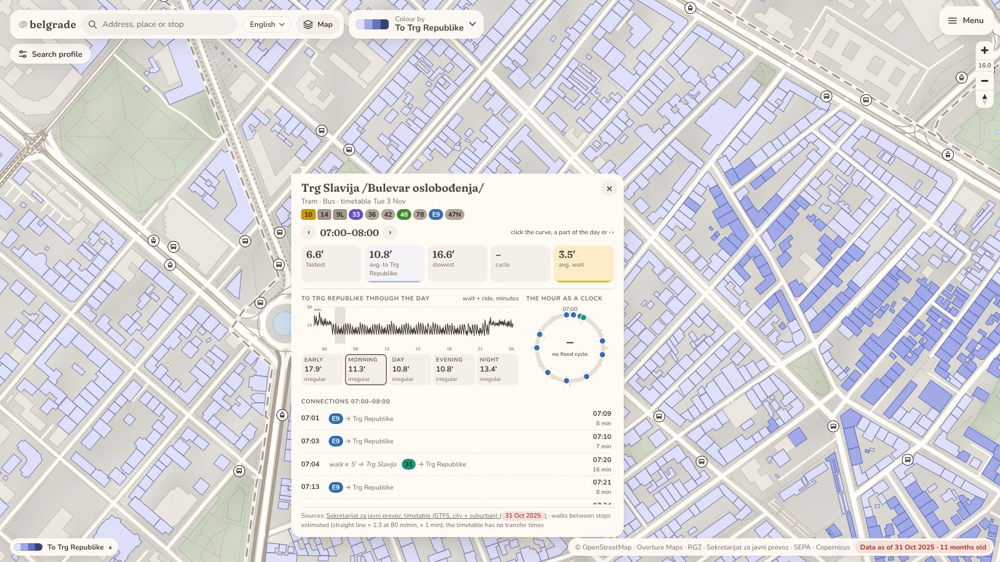
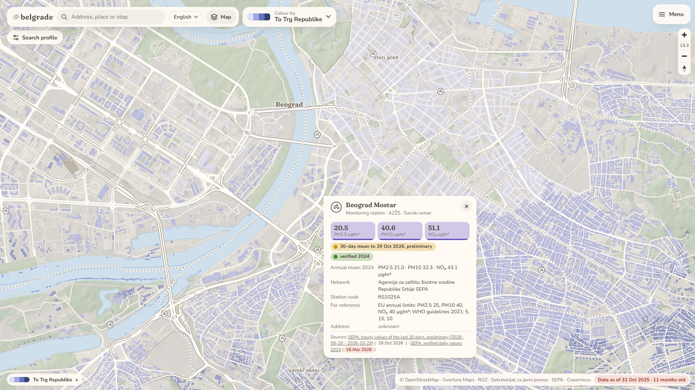
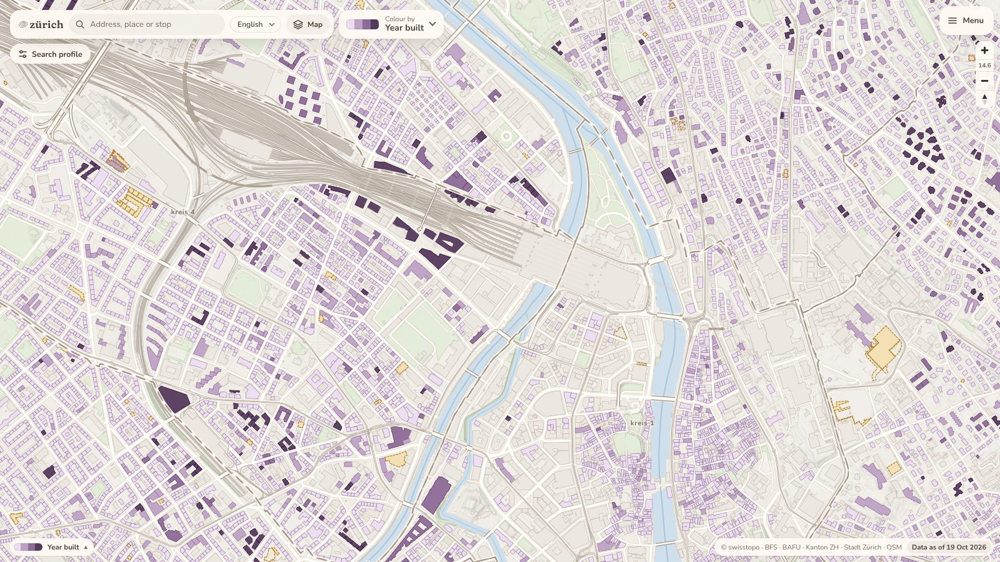

# bg: Belgrade from open data

**Open the map: [bg-gules-iota.vercel.app](https://bg-gules-iota.vercel.app/)**
(in Serbian; switch to English in the language menu, or add `?lang=en`)

Every building in Belgrade on one map, with what public data says about it:
its address, how long the trip to Trg Republike takes, what's near on foot, the
stops and their timetables, and the air at the nearest measuring station.

The map is made only from **open data**: OpenStreetMap, the national address
register, the city's public-transport timetable and the environment agency's
air-quality network. Nothing is guessed. Where no open source exists, the map
says so instead of hiding the feature or making something up. "Year built",
for example, shows greyed with *not available in Belgrade*.

## What you can do

- **Find an address, a place or a stop.** Type in the search field at the top
  left: "Resavska 92", "Slavija", a school's name. Pick a result and the map
  flies there and opens its card.
- **Click a building** for its card: footprint and floors where they're
  recorded, the estimated trip to Trg Republike and the stop it starts from with
  its lines, the nearest kindergarten, school, supermarket, pharmacy, doctor,
  playground and pool on foot, and every source with its date.
- **Colour the map** ("Boji po" / "Colour by", next to the search) by the trip to
  Trg Republike, by walking time to a kind of place, or by floors. The legend
  at the bottom left explains the colours and says what's missing.
- **Look up a stop.** Switch on *Stops* in the map menu ("Karta" / "Map") and
  click one. Its card shows the trip to Trg Republike through the day: the
  fastest, average and slowest trip and the wait for any hour, and the next
  connections with their lines.
- **Check the air.** Switch on *Air quality* in the map menu. Each of the 24
  measuring stations has a card with the last 30 days' average of PM2.5, PM10,
  NO₂ and O₃, and the verified yearly averages where the agency publishes them,
  next to the EU limits and WHO guidelines for reference.
- **Find buildings that fit.** In the *Search profile* (top left), add criteria:
  at most 20 minutes to Trg Republike, a school within 10 minutes on foot, ...
  Buildings that don't fit fade out, and the panel counts how many homes do.
  You can also just mark matching buildings instead of filtering.
- **Share a setup.** The address bar keeps the colouring, the layers and places
  that are on, the search profile and the language, so a copied link opens the
  map set up the same way (at its start position).
- **On a phone** the cards and menus open as sheets from the bottom.

<table>
<tr>
<td></td>
<td></td>
</tr>
<tr>
<td>A stop's card: trips to Trg Republike through the day</td>
<td>An air-quality station: the last 30 days and the verified year</td>
</tr>
</table>

## Zürich, the reference

The same map also runs for the City of Zürich, at
[/zurich/](https://bg-gules-iota.vercel.app/zurich/) ("Referenca: Cirih" in
the menu). Switzerland publishes much more as open data: year built, number of
flats, heating, noise, zoning, natural hazards, land plots, solar potential.
So the Zürich map shows what the Belgrade map looks like where a source exists.
It's a reference, refreshed rarely; the work goes into Belgrade.

## Where the data comes from

- **Buildings, streets, water, green areas, places:** OpenStreetMap and Overture
  Maps (ODbL; building outlines partly from Microsoft's machine-learning set).
- **Addresses:** the national address register (RGZ).
- **Stops and timetables:** the city's Secretariat for Public Transport (GTFS,
  city and suburban lines).
- **Air quality:** the Serbian Environmental Protection Agency (SEPA): its open
  data API, and its verified daily values.
- **Relief:** the Copernicus elevation model.

Every card lists its sources and their dates. The pin at the bottom right shows
how old the map's data is. Licences and attributions: [NOTICE.md](NOTICE.md).

## Help build it

The map is built by people working with Claude: pick an item from the
[backlog](backlog/), let Claude build it, review the preview, merge. How that
works: [CONTRIBUTING.md](CONTRIBUTING.md). Building the site and refreshing the
data: [docs/development.md](docs/development.md).

Code: MIT ([LICENSE](LICENSE)). Data: each source's own licence ([NOTICE.md](NOTICE.md)).
